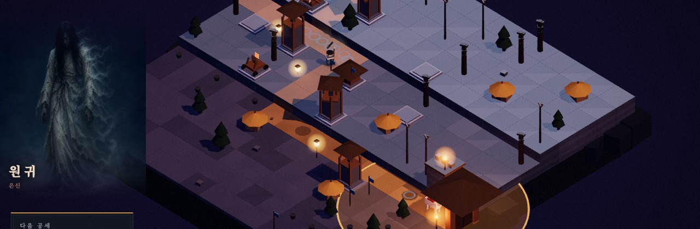

### AI를 지휘해 완성품을 만듭니다

만드는 일보다, **만들어진 것을 무엇으로 검증할지 설계하는 데** 시간을 씁니다.

[English below](#en)

---

## 수성 (守城)

역병으로 일어난 망자에게서 조선의 성을 지키는 2.5D 아이소메트릭 디펜스입니다.
브라우저에서 링크 하나로 시작하고, 설치도 계정도 결제도 없습니다.

[**▶ 플레이**](https://susung.pages.dev/) · [저장소](https://github.com/Jaewookim0213/Susung)

| | |
|---|---|
| 만든 기간 | 23일 (2026년 7월 18일 ~ 8월 10일) |
| 코드 | 11,220줄 · 커밋 156개 |
| 담긴 것 | 전장 13장 · 적 13종 · 포탑 12종 · 장수 3인 |
| 언어 | 한국어 · English · 日本語 (화면과 대사, 줄글까지 전부) |
| 외부 3D 파일 | **0개.** 모든 모델을 코드가 실행 중에 만듭니다 |
| 의존성 | Three.js 하나뿐이고 그것도 저장소에 담았습니다 |

삽화 49장은 ChatGPT와 Midjourney로, 음악 7곡은 Suno로 만들었습니다.
코드는 Claude Code와 함께 썼습니다.

---

## 이 프로젝트에서 실제로 설계한 것

AI로 게임을 만들면서 어려웠던 부분은 만들어 내는 쪽이 아니었습니다.
**생성된 결과물은 그럴듯하게 틀립니다.**
화면을 그리는 코드가 조용히 실패해도 게임은 오류 없이 계속 돌아가고,
밸런스가 무너져도 판은 끝까지 굴러갑니다.

그래서 시간을 들인 것은 게임 코드가 아니라 **결과물을 그대로 믿지 않기 위한 장치**였습니다.
화면 없는 브라우저로 게임을 실제로 돌려 숫자를 받아 오는 도구를 스무 개 만들었습니다.

| 재는 것 | 잡아낸 것 |
|---|---|
| 화면 휘도 | 수정하다 화면이 기준선 아래로 어두워진 것 |
| 화면 크기 5종 × 게임 화면 10종 | 손이 닿지 않는 버튼, 잘려서 안 보이는 글자 |
| 전장 13개 자동 완주 | 밸런스가 나빠졌는지를 기준선 표와 견주어 판정 |
| 글꼴 문자표 | 브라우저가 대신 그려 줘서 화면으로는 못 보던 빠진 글자 |
| 번역 표 | 비어 있으면 오류 없이 한국어가 그대로 나오던 자리 |

그리고 **틀린 것을 고치는 데서 끝내지 않고 지시서에 규칙으로 남깁니다.**
그 문서가 508줄까지 자란 것은 정성껏 써서가 아니라 23일 동안 그만큼 틀렸기 때문입니다.

---

## 지금 만들고 있는 것

같은 장르를 **Codex로 한 번 더** 만들고 있습니다.
스토리와 컷신을 앞세운 디펜스이고, 배경은 수성과 전혀 다릅니다.

도구를 바꾸면 무엇이 달라지는지, 수성에서 세운 검증 방식이 그대로 통하는지 보려고 합니다.

---

## English

I direct AI to build finished products, and I spend more time designing
**how to verify what gets built** than building it.

**[Susung (守城)](https://susung.pages.dev/)** is a 2.5D isometric defense game set in
Joseon-era Korea. Built in 23 days: 11,220 lines, 13 battlefields, 13 enemy types,
12 towers, three languages, and **not a single external 3D asset** since every model is
generated by code at runtime. Its only dependency is Three.js, vendored into the repo.

The hard part was never generation. **Generated output fails plausibly.** A shader can
fail to compile without raising anything and the game keeps running; balance can collapse
and the match still plays to the end. So what I actually designed was the apparatus for
*not* trusting the output: twenty tools that drive a headless browser through the real
game and report numbers, and a 508-line instruction file where every mistake becomes a
rule so the next session does not repeat it.

I'm currently building the same genre again with Codex, with a different setting and a
stronger focus on story, to see what changes when the tool changes.

[LinkedIn](https://www.linkedin.com/in/jaewoo-kim-analytics/)

